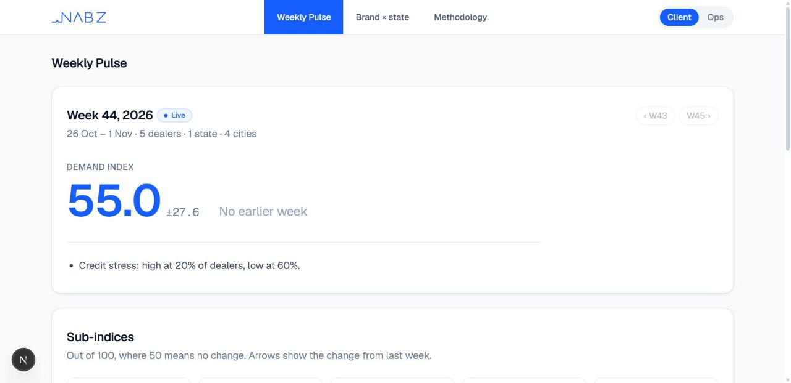
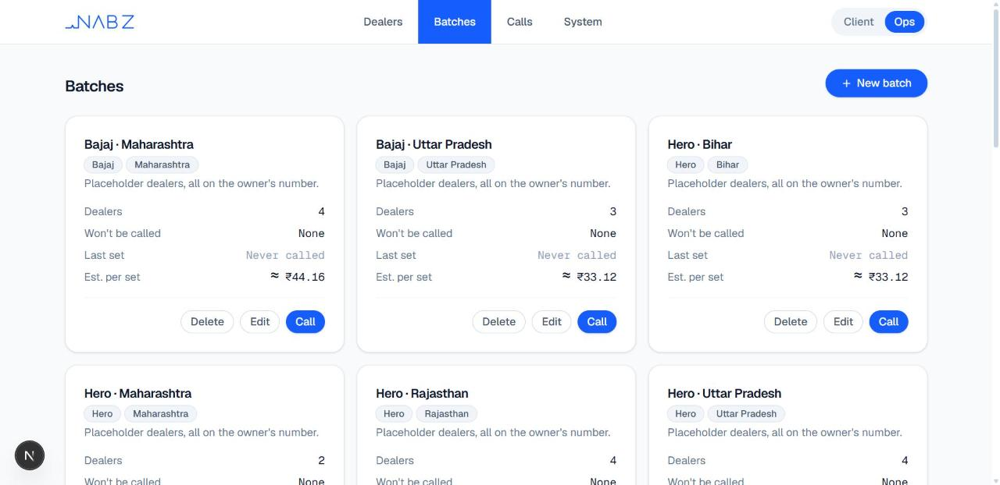

# Nabz

Weekly demand indices for India's offline economy, built from short AI phone surveys of businesses.

The first sector is vehicles. A Bolna voice agent calls dealers in their own language and asks about this week's enquiries, bookings, stock, discounts and loan rejections. Their answers become a 0–100 Demand index by brand and state, with margins of error.

## What it looks like

The Weekly Pulse, built from 5 real test calls:



Batches in the Ops console, using our own test dealers, all on our own phone number:



## How a call becomes an index

1. **Ops** adds dealers and groups them into batches.
2. **Calling a batch** starts a set: one call at a time, each using the agent for the dealer's language.
3. **Bolna** places the call. The app collects the transcript and answers, and checks their quality.
4. **The index engine** scores the answers. The **client pages** (Weekly Pulse, Brand × state, Methodology) show the result on every request.

Clients never see a dealer's name or number.

## It starts empty

There is no sample data. A new copy has no dealers, batches or calls, and every page says so until real calls are answered. Nothing on the client pages is made up: every number comes from an answered call.

## Testing and production

One setting, `NABZ_MODE` in `.env.local`, decides who can be called. It defaults to `testing`.

|                                     | `testing` (default)                                       | `production`      |
| ----------------------------------- | --------------------------------------------------------- | ----------------- |
| Add a dealer or change their number | Only numbers in `ALLOWED_NUMBERS`, otherwise an error     | Any valid number  |
| Call a batch, Test call             | Only numbers in `ALLOWED_NUMBERS`                         | Any dealer        |
| Everything else                     | The same                                                  | The same          |

In testing, any other number gets this error:

> This number isn't allowed in testing mode. To call other numbers, set NABZ_MODE=production and add a premium Bolna API key in .env.local, then restart the app. See the README for the full steps.

In both modes, calls run one at a time, nothing dials unless `CALLING_ENABLED=true`, and spending stops at the daily limit (`BOLNA_DAILY_SPEND_CAP_USD`, $10 at most).

## Run it

You need Node 24, pnpm 11 and PostgreSQL 16 or newer.

```sh
pnpm install
```

Then set up the database, in one of two ways.

**With an empty database you've already made:** copy `.env.example` to `.env.local` and set `DATABASE_URL` to it.

**Or let the app create it:** put a Postgres superuser URL in `.env.bootstrap.local`, for example `PG_SUPERUSER_URL=postgres://postgres:<password>@127.0.0.1:5432/postgres`, then run `pnpm db:bootstrap`. This creates the databases and `.env.local`.

Then:

```sh
pnpm db:setup
pnpm dev
```

Open http://localhost:3000. Client pages start at `/pulse`, and the Ops console is at `/ops`.

Everything works at this point except calling. No Bolna key is included, and none is needed to look around.

## Make a real call (testing mode)

You need your own Bolna account, and you pay for the calls from it. Calls have cost us about 12–18¢ each.

1. Create a Bolna API key. On a trial account, also verify your phone number with Bolna, because trial accounts only reach verified numbers.
2. In `.env.local`, set:
   ```sh
   BOLNA_API_KEY=<your key>
   ALLOWED_NUMBERS=<your number, for example +919000012345>
   CALLING_ENABLED=true
   ```
3. Create the voice agents in your account, then record them in the database. Neither step places a call.
   ```sh
   pnpm agents:create
   pnpm agents:sync
   ```
4. Run `pnpm dev`, then add yourself as a dealer in Ops → Dealers.
5. Press **Test call** in that dealer's Edit pop-up to hear the agent. A test call changes no data.
6. To put answers on the client pages, add yourself to a batch in Ops → Batches and press **Call**. Keep the set's page open, because closing it pauses the set.

## Switch to production

1. In `.env.local`, set:
   ```sh
   NABZ_MODE=production
   BOLNA_API_KEY=<your premium Bolna key>
   CALLING_ENABLED=true
   ```
2. If the key belongs to a different account, run `pnpm agents:create` and `pnpm agents:sync` again.
3. Restart the app. Ops → System shows the mode.

Read the limits below first. **Production has no opt-out, do-not-call list or calling hours yet, so it must not be used to call real dealers until they're added.**

## What's proven and what isn't

- **Real calls:** the full path has only run on a Bolna trial account, on our own phone numbers. No real dealer has been called.
- **Production mode:** tested with simulated Bolna responses only, not with a premium key.
- **`pnpm agents:create`:** tested with simulated Bolna responses only, not against a real account. The agents it creates are built from the same definitions as our live ones. Voices may vary by Bolna account.
- **Languages:** 12 agents exist. English, Hindi, Tamil and Odia have had real calls. The other 8 are drafts awaiting a native speaker's review.

## What has to happen before real dealers are called

- **Opt-out, do-not-call and calling hours** must be added. Our legal brief requires all three.
- **TRAI rules:** whether survey calls need an A2P declaration or DLT is still an open question for Bolna.
- **Paid Bolna plan:** trial accounts only reach verified numbers, and at most 2 calls at once.
- **Batch calling:** calls run one at a time today, and running many at once is the next step.
- **Ops login:** Ops has no password, so don't host it publicly with a real Bolna key. Anyone who can open it can edit dealers and place calls.
- **Small groups:** brand × state cells below 3 dealers are hidden, but the national, brand and state numbers aren't. With very few calls, one dealer's answers could be the whole number. This needs a new survey version, because used versions are frozen.

## Checks

```sh
pnpm check   # typecheck, lint, unit and database tests, production build
```

The database tests need `DATABASE_URL_TEST` pointing at a database named `nabz_test`, which they rebuild from scratch. All Bolna traffic in tests is simulated, so they can never place a call.

Rules for working in this repo are in [`CLAUDE.md`](CLAUDE.md).
